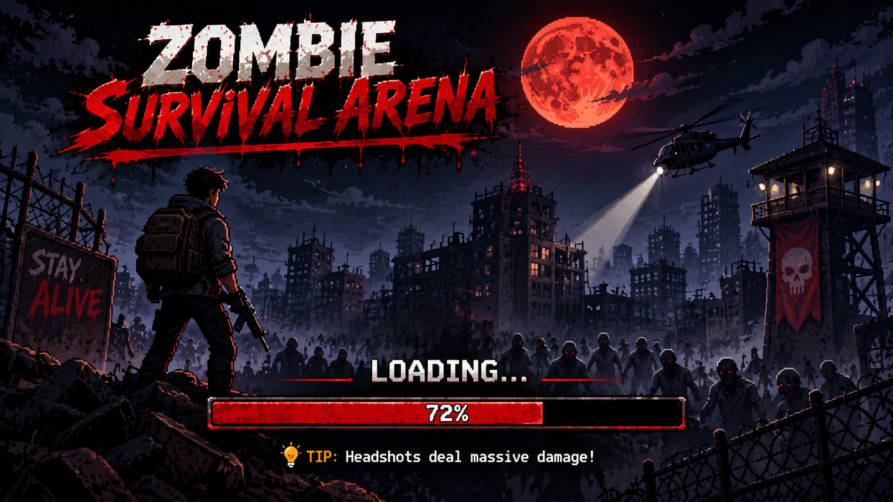

# ☣️ ZOMBIE SURVIVAL ARENA

### **SURVIVE THE HORDE. FIGHT FOR YOUR LIFE.**

A 2D top-down zombie survival shooter built with **C++ and SFML 3**. Fight against waves of zombies, manage your weapons, survive as long as possible, and prove that you can make it out alive.

<p align="center">
  
</p>

<p align="center">
  
  
  
  
</p>

---

## 🎮 ABOUT THE GAME

**Zombie Survival Arena** is a pixel-art-inspired 2D top-down survival shooter where the objective is simple: stay alive.

Face zombie enemies, use your weapons, survive incoming waves, and build your survival progress. The game combines C++ programming with the SFML multimedia framework to deliver a desktop gaming experience.

## ⚔️ GAME FEATURES

| Feature | Description |
|---|---|
| 🧟 Zombie Enemies | Fight against zombie enemies and animations |
| 🔫 Combat System | Move, aim and shoot to survive |
| 🌊 Zombie Waves | Face increasingly challenging survival encounters |
| 💾 Save System | Save and load your game progress |
| 🔊 Audio System | Sound effects and background music |
| 🎨 Pixel-Art Identity | Custom game icon and visual presentation |
| 🖥️ Game Interface | Menus, HUD and loading screen |
| 📜 Credits Screen | Dedicated developer credits |

## 🕹️ CONTROLS

| Key | Action |
|---|---|
| W / A / S / D | Move player |
| Mouse | Aim |
| Left Mouse Button | Shoot |
| ESC | Pause / Exit menu |

*Controls may vary depending on the current game configuration.*

## 🛠️ BUILT WITH

This project was developed using:

- **C++17** — Core programming language
- **SFML 3** — Graphics, audio, window and multimedia
- **MSYS2 / MinGW-w64** — C++ development environment
- **Visual Studio Code** — Code editor
- **Git & GitHub** — Version control and project hosting

## 📂 PROJECT STRUCTURE

```text
Zombie-Survival-Arena/
│
├── assets/
│   ├── backgrounds/
│   ├── icons/
│   ├── sprites/
│   ├── sounds/
│   └── music/
│
├── config/
├── docs/
├── examples/
│
├── include/
│   └── systems/
│       └── SaveManager.h
│
├── resources/
│   └── app.rc
│
├── src/
│   └── systems/
│       └── SaveManager.cpp
│
├── .vscode/
├── main.cpp
├── .gitignore
└── README.md
```

## 🚀 PLAY THE GAME

### Windows Portable Edition

1. Visit the [Releases](../../releases) section.
2. Download `ZombieSurvivalArena_Final.zip`.
3. Extract the ZIP file.
4. Open the extracted game folder.
5. Double-click `ZombieSurvivalArena.exe`.
6. Start surviving!

**Important:** Keep the executable, assets folder and required DLL files together. Do not move the executable out of its game folder.

## 💻 BUILD FROM SOURCE

Want to explore the code or build the game yourself?

### Requirements

- Windows
- MSYS2 UCRT64 environment
- GCC / MinGW-w64
- C++17 compatible compiler
- SFML 3 development libraries

### Clone the repository

```bash
git clone https://github.com/ameyabobade007-ux/Zombie-Survival-Arena.git

cd Zombie-Survival-Arena
```

### Compile the game

```bash
g++ -std=c++17 main.cpp src/systems/SaveManager.cpp \
-Iinclude -o ZombieSurvivalArena.exe \
$(pkg-config --cflags --libs sfml-graphics sfml-audio)
```

*Make sure SFML 3 and its required development packages are installed in your MSYS2 UCRT64 environment.*

## 👨‍💻 DEVELOPER

<p align="center">
  <strong>AMEYA BOBADE</strong><br>
  C++ Game Developer<br>
  <em>Designed and developed with passion for game development.</em>
</p>

<p align="center">
  <a href="https://github.com/ameyabobade007-ux">
    
  </a>
</p>

## 🙌 ACKNOWLEDGEMENTS

- The SFML development community.
- The creators of the tools and resources used in this project.
- The artists and creators of third-party assets, subject to their respective licences.

## 📌 PROJECT INFORMATION

| Detail | Information |
|---|---|
| Project | Zombie Survival Arena |
| Genre | 2D Top-Down Zombie Shooter |
| Language | C++ |
| Framework | SFML 3 |
| Platform | Windows |
| Version | 1.0.0 |
| Developer | Ameya Bobade |

---

<p align="center">
  **THE DEAD DON'T REST. NEITHER SHOULD YOU.** ☣️
  <br><br>
  Made with ❤️ and C++
</p>
